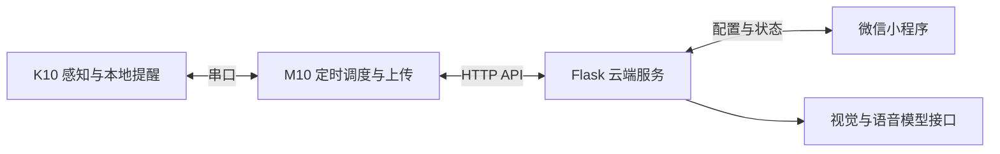
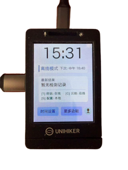
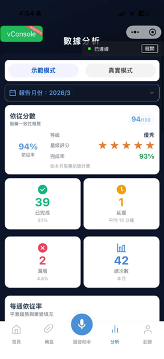

# 智能药箱 SmartMedBox · IoT 实体版

面向独居长者与慢性病患者的用药提醒与取药状态辅助核查原型，连接 IoT 设备、云端服务与微信小程序。

## 本版成果与前期关系

本仓库保存最初上传的 IoT 参赛程序，侧重软硬件整合、实体原型和本地感知与提醒。2026 年获国际青少年创科教育大赛（澳门区）IoT 中学组优异奖（团体）；另参加澳门科学馆公开展示。

此前的微信小程序大赛版以小程序设计、交互及板端运行为重心，当时尚未制作本版实体药箱，另存于 [微信小程序大赛版仓库](https://github.com/Thomascheong2009115/smartmedbox-miniprogram)。两版有主题与技术上的延续，按实际差异分别归档。科学馆展示的具体日期与现场照片尚未收录。

## 个人参与与协作

张皓泓全程参与需求与功能设计、AI 生成代码的调试整合及实体原型制作。代码由 AI 辅助生成，不代表个人独立手写。项目为团队合作；IoT 提交材料列有张皓泓、吴梓轩、全卓谦，指导老师为陈油。微信小程序赛与 IoT 阶段的参赛团队名单不同，不能混用。

原提交材料另外披露使用 Gemini 辅助初期方向和技术建议、ChatGPT 辅助文档整理，并接入预训练视觉模型。没有自训练药物识别模型的主张。

## 系统组成



- `src/k10.py`：相机采集、温湿度感知、本地显示与提醒、串口协议等板端程序。
- `src/m10.py`：定时任务、串口状态、上传、复查、配置同步和交互界面。
- `src/server.py`：配置与状态 API、图片分析、语音相关接口和记录存储。

视觉功能根据取药区图像辅助核查药物是否仍在区域内，不能据此证明使用者实际吞服药物。本作品为学生项目原型。

## 原提交材料中的运行界面

下图为板端及小程序界面，不是澳门科学馆展示现场照片。

  

## 环境与运行入口

后端依赖按实际 import 整理，尚未锁定原运行环境版本；不是已经验证的一键部署环境。

```bash
python -m pip install -r requirements-backend.txt
# 将 .env.example 中所列配置设为进程环境变量
python src/server.py
```

后端还涉及音频处理环境。M10 使用 UNIHIKER、串口设备及对应硬件依赖；K10 程序需在匹配固件与外设的设备上运行，不能直接在普通电脑上验证。

公开归档将原默认远端地址改为本机地址；连接实际后端时设置 `SMARTMEDBOX_CLOUD_BASE_URL`。API 密钥通过环境变量提供。程序不会自动加载 `.env`。

## 当前归档边界

- 已包含三个原程序、结构与分阶段说明、原提交材料中的运行界面。
- 本仓库尚未包含与 IoT 提交时点对应的小程序源码、实体展览照片或完整硬件接线说明；另一个仓库保存本次补充的微信小程序大赛版资料，尚未核实两版接口完全兼容。
- 尚未重新进行云端 API、硬件与小程序端到端联调。

## 代码整理

精简重复说明、对话式注释及夸张标题，保留接口结构、硬件协议和时序。外部服务地址与密钥改为环境变量配置；缺少配置时不发起相应请求。已完成 Python 语法检查及服务配置边界测试，尚未重跑云端服务或硬件联调。

## 公开版本的服务配置

API 密钥、令牌及真实服务地址不随源码提供。后端从进程环境变量读取 `TENCENT_API_KEY`、`TENCENT_CHAT_URL`、`SILICONFLOW_API_KEY` 和 `SILICONFLOW_TRANSCRIPTION_URL`，默认均为空。需自行填入自己的配置，程序不会自动读取 `.env`。未配置相应密钥或地址时，相关云端功能返回未配置状态，不会向原服务地址发起请求。

板端与小程序保留本机回环地址作为开发占位；按自己的环境设置服务连接。公开归档不含本地私有配置、运行日志、上传文件和原始压缩包。依赖来源及开源许可链接保留。
