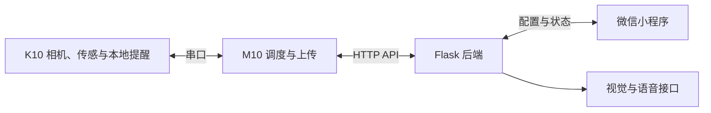

# 智能药箱 SmartMedBox · IoT 实体版

一个结合实体药箱、M10/K10 板端程序和云端服务的用药提醒原型。面向需要定时用药的场景，提供本地提醒、取药区图像核查、状态同步和语音交互，让用药安排与药箱状态能够连起来查看。

## 主要功能

- 定时提醒：按设定时段进行本地显示与提醒。
- 图像核查：采集取药区图像，通过视觉接口辅助判断药物是否仍在区域内。
- 状态同步：将提醒、核查及设备状态上传到后端，供界面查询。
- 语音交互：通过后端接口处理录音和语音问答。
- 环境感知：采集并显示温湿度信息。

图像核查反映的是取药区的状态，无法直接判断使用者是否已经吞服药物。

## 系统组成



- `src/k10.py`：相机采集、温湿度感知、本地显示、提醒和串口通信。
- `src/m10.py`：定时调度、配置同步、图像上传、复查和状态处理。
- `src/server.py`：配置与状态接口、图像分析、语音处理和记录存储。

## 工作流程

1. 设置用药时段，由后端保存配置并同步到板端。
2. M10 根据时间安排触发任务，通过串口与 K10 配合进行提醒和采集。
3. 图像上传到后端，调用视觉接口分析取药区状态。
4. 根据返回结果更新状态，按程序设定进行后续复查。
5. 界面查询最新状态和记录，展示提醒与核查情况。

## 实现思路

在前期 [微信小程序版](https://github.com/Thomascheong2009115/smartmedbox-miniprogram) 的用药管理与交互基础上，将重点扩展到实体制作和设备协作。把相机、传感和本地提醒放在 K10，将调度、上传和复查放在 M10，再由后端统一处理配置与模型接口，形成从设定时间到提醒、核查、记录的完整流程。

实体原型曾在澳门科学馆公开展示。

## 运行界面

  

## 运行方式

```bash
python -m pip install -r requirements-backend.txt
python src/server.py
```

启动前，按 `.env.example` 将密钥与服务地址设为进程环境变量。后端读取 `TENCENT_API_KEY`、`TENCENT_CHAT_URL`、`SILICONFLOW_API_KEY` 和 `SILICONFLOW_TRANSCRIPTION_URL`；未配置时，相应云端功能返回未配置状态。程序不会自动读取 `.env`。

板端连接后端时设置 `SMARTMEDBOX_CLOUD_BASE_URL`。M10 需要 UNIHIKER、串口及相关依赖；K10 需要匹配的固件和外设。仓库包含板端与后端源码、运行界面和配置示例，IoT 对应的小程序源码与完整接线说明尚未收录。

开发过程中使用了 AI 辅助生成代码，并进行调试、软硬件整合及实体制作。
